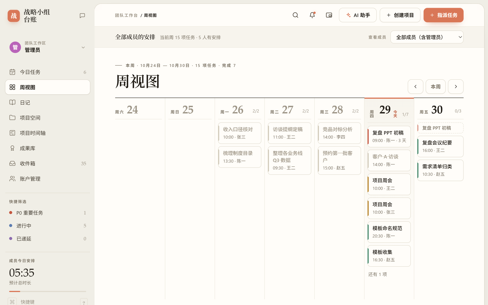
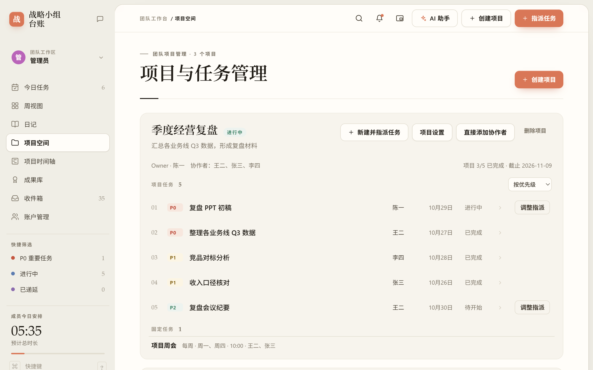
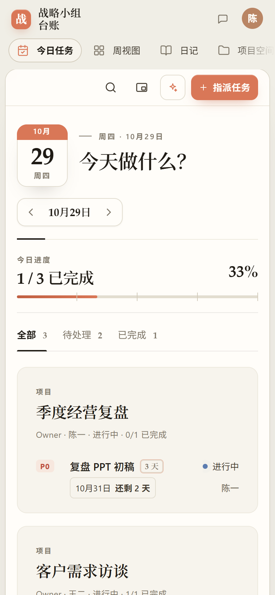

# Work Calendar

**A self-hosted task and project workbench for small teams.** One Python file and one SQLite database, no runtime dependencies, and your data stays on your own machine. The interface is in Chinese; its built-in name is 战略小组台账.

[](https://github.com/Ray-hola/work-calendar/actions/workflows/tests.yml)
[](LICENSE)
[](#requirements)
[](#requirements)

[Quick start](#quick-start) · [Docker](#docker) · [Features](#features) · [Where to change things](#where-to-change-things) · [中文](README.md)



## Why

Most collaboration tools want your tasks, daily notes and team data in someone else's cloud. Work Calendar keeps the whole loop (plan → do → finish → archive) and its rules in one auditable local service: `server.py` plus a SQLite file, reached on a local port and published through Cloudflare Tunnel or a reverse proxy when you need outside access.

## Features

**Tasks**
- Three kinds: project tasks, one-off tasks (outside any project; members can create them for themselves or other members under their rule group, and the creator follows progress and reviews edit requests), and fixed tasks (daily, workdays, chosen weekdays, monthly or specific dates; can belong to a project; single days can be skipped).
- Finishing a task needs no approval. The assignee can correct the completion record, and the project Owner or an admin can send it back with a reason.
- Work left unfinished, fixed tasks included, carries to the next day automatically; the old day is hidden and leaves the counts. Manual deferral to a chosen date also works. The 已递延 (deferred) list and its count include only current deferred tasks that are still to do or in progress, once per task. Completed or skipped tasks leave the list, and reopened tasks return; deferral history stays in task details.
- When assigning, you see how many hours the person already has inside the task's own dates.

**Projects**
- Rule groups: under 系统设置 (system settings) in the sidebar, separate from the superadmin / admin / member roles, superadmin keeps rule groups for ordinary members. Existing groups are listed one per row; creating a group or opening one shows a card where one click sets whether a new project, a one-off task and a task inside a project one collaborates on is created directly, needs approval, or is not allowed, and whether the AI assistant is off, can answer and draft plans, or can act on the member's behalf; members are picked right on the card, all at once if needed. Members in no group follow the default rules: request projects, create one-off tasks directly, and use the assistant for questions and plans. A project task request goes to that project's Owner, a one-off task request to the admins. The top bar shows "+ New project / Request project" and "+ New task / Request task" to match. The diary automation settings live in 系统设置 too; account management only manages accounts.
- Project settings change the name, dates and collaborators; admins can also hand a project to a new Owner. Added collaborators join immediately with a notice, without accepting an invitation. Members can leave while keeping their tasks and records. New projects and assigned tasks carry fresh marks in the project space until opened.
- Open-ended project workload covers today minus 6 days through today plus 7 days; bounded projects use their own period. Tasks count when their dates overlap the window, with only the current deferral occurrence and no skipped tasks. Open, completed and duration figures in project staffing share that window.
- Project tasks sort by priority, start or end date, or a manual drag order. The timeline view draws every project on one date scale.
- Project spaces provide a folder → project directory, background notes, member responsibilities and attachments. Admins manage the full directory; member state responses and navigation include only folders used by projects they can access. Edits made while a background save is pending remain unsaved until submitted, and failed saves can be retried.
- The project directory sits at the far left of the page. A folder lists all its projects, sortable by directory order, name, deadline, progress or creation time; clicking a project card or directory entry opens its space. Admins can drag every entry and Owners their own projects: a drop line toward the left lands beside a folder, toward the right inside it, and releasing over a folder files the project into it.
- Project titles are keyboard-focusable and open with Enter. Dropping outside the directory, Escape, window blur or pointer cancellation discards a drag. Further drags wait for the current save, and failed saves restore server state. Drag motion respects reduced-motion preferences.
- Project files support selection or drag-and-drop upload, download and permission-checked deletion, up to 20MB each. Attachments from completed, archived or expired projects remain available through 归档文件 (archived files) in the project directory; admins can also enter from the achievements archive. Existing project viewers and admins retain read access; outsiders cannot read them, and archived files cannot be uploaded or deleted.
- Project Owners submit a closing report for admin approval; admins can also finish a project directly. A project can close early, with its unfinished tasks listed before confirmation and closed along with it. Closed projects move to the achievements archive.

**Collaboration and records**
- Per-recipient inbox: delete a notice from its card, or switch to 管理 to delete several or clear the read ones. A chat area with shared rooms and one room per project, with @mentions.
- Archive room (the former diary and archive merged): one line-drawn archive box per month, with arrows to change month. Slide the pointer across the box, drag the date ruler below it or turn the wheel to pick a folder, and click to open it. Members see their own personal archive; admins see team briefs and can read member diaries. Project Owners do not receive diary text:
  - Members: one archive a day, pre-filled from that day's tasks (done / open and blocked / next) with the day's work log attached and a separate 随记 (personal notes) section excluded from team briefs. Open it and edit it in place, then save. 记录今天 opens today's. Days left unwritten are filled in from the tasks at 23:30.
  - Admins: one team brief a day (made the next morning: members' summaries, project progress, what needs attention), also editable in place; a diary filed later does not overwrite what was changed. Under the box are the picked day's work log, member load and project progress. 本周周报 opens the selected week's report (using the configured week start; Saturday to Friday by default) in place, showing totals, daily completions, member load and project progress. Arrows switch weeks; clicking a filed day opens its brief.
- Desktop widget: an always-on-top picture-in-picture window with today's to-dos and a pomodoro timer (Chrome / Edge on desktop).
- AI assistant (optional): admins configure an OpenAI-compatible endpoint; the key stays on the server. Press 规划任务 (plan) and say in one sentence what needs doing; the assistant lays out project and task cards that are already filled in and split up. Each card can be edited (assignee, date, time, priority and so on), removed, or joined by a new one, and on confirm they are created, or requested, under your own rules. Nothing is written before you confirm.
- AI connection: presets for OpenAI, Anthropic Claude, Google Gemini, DeepSeek, Kimi, Qwen (DashScope), Zhipu GLM, SiliconFlow, OpenRouter and local Ollama, or any OpenAI-compatible address. 测试连接 (test connection) lists the models the key can use and has the chosen one answer, fills the model picker, and states why a failure happened (bad key, wrong address, quota and so on). Admins can switch models from the chip in the assistant header.
- What the assistant sees: open tasks always go in whole; finished tasks go as a compact index, and their details, reports, diaries and all notices sit in monthly chunks the model fetches when needed (up to 4 lookups per answer). How much data it is given is a choice in the configuration.
- AI collaboration: editable plan cards open to the left of the conversation, with a stacked layout on phones. Missing names and unresolved assignees remain blank and are marked red; confirmation waits until required fields are complete. Incomplete replies or connection failures still leave an editable draft. Use ↑ to recall the last input, copy messages, edit and resend, rewind the current conversation, or undo and copy draft changes. Pause / resume retains progress; stop keeps drafts and receipts, lets an already-sent operation finish, then prevents further steps. Rewinding a conversation does not undo created data.
- Conversation history opens in the assistant’s left sidebar with create, switch, rename and delete actions; empty conversations persist too. Message copy, edit/resend and rewind use icons. Drafts and unsent input stay with their conversation in the current page; admin review of another account is read-only and cannot execute drafts. Sending waits for history to load, and stale responses cannot overwrite a newer selection.
- Personal signature: one line written in your profile, shown under the avatar in the sidebar, the account menu and the account list.

**Layout and access**
- Desktop, tablet and phone layouts. Admins choose the team week start in system settings; calendar weeks, archive ranges and weekly briefs follow it.
- Resize the AI assistant from its transparent left edge (width), top edge (height), or top-left corner (both), with no visible grip. Plain chat, history, planning and combined layouts remember their own sizes. Viewport clamps preserve desired sizes. Double-click an edge to reset; Esc cancels a drag. Focus an edge for arrow-key adjustments, Shift for larger steps, Home for defaults and End for the maximum.
- Scrollbars stay hidden throughout the app while wheel, touch and keyboard scrolling remain available. Drag the right edge of the main navigation, project directory or chat channel rail to resize it, or use its arrow to collapse / expand. The narrowest desktop state keeps icons and full-name tooltips; overflowing labels fade at the end. Desktop width ranges are 72–360, 56–340 and 64–320 px respectively, with smaller effective maximums when content space is limited. Widths and previous expanded sizes are saved in the current browser and restored on reload.
- Focus a divider to use Left / Right (Shift for larger steps), Home / End for the limits, or Enter to collapse / expand; double-click to reset its width. Esc cancels a drag. Phones retain the horizontal main navigation. The project directory on tablets and phones, and the phone channel list, collapse / expand without squeezing the content. Motion respects the system's reduced-motion preference.
- Identity is one of three roles: superadmin, admin or member. Being a project's Owner or a collaborator only decides what one can do inside that project. The server refuses anything beyond these rights. Account management is visible to admins only: superadmin drags accounts to reorder them or move them to another role, or presses 管理 (manage) on a role to tick several accounts and disable / enable, delete, reset the password to 123456 or set the Chinese name. Account switching in the avatar menu lists only accounts that signed in on that browser.

<p align="center">
  
  
</p>

## Requirements

- **Python 3.11+**, standard library only (CI runs the tests on 3.11 and 3.12).
- On Windows, time-zone data: `python -m pip install tzdata`.
- **Node.js 18+**, only for the front-end tests (CI uses 20).
- A current browser; the desktop widget needs Chrome / Edge 116 or later.

## Quick start

macOS / Linux:

```bash
./run.sh
```

Windows (PowerShell):

```powershell
Set-ExecutionPolicy -Scope Process Bypass
.\run-windows.ps1          # run in the foreground from this folder
.\install-windows.ps1      # or install to %LOCALAPPDATA%\WorkCalendar and start at sign-in
```

Open `http://127.0.0.1:4173/`. The first start creates `data/work-calendar.sqlite3` and `data/initial-accounts.txt`; the latter holds random passwords for the seeded accounts `superadmin`, `test001` (project Owner) and `test002` / `test003` (collaborators). Change them after the first sign-in.

> The page has to be served by the local server; opening `index.html` directly cannot reach the API.

### Docker

```bash
docker compose -f deploy/docker-compose.example.yml up -d --build
```

The image holds only the four runtime files, and data is mounted from the repository's `data/`. Public access, Tunnel and backups are covered in the [deployment guide](deploy/README.md#docker) (Chinese).

## Configuration

Use environment variables or command-line flags; flags win.

| Variable | Default | Meaning |
| --- | --- | --- |
| `WORK_CALENDAR_HOST` | `127.0.0.1` | Listen address; keep it on loopback behind a reverse proxy |
| `WORK_CALENDAR_PORT` | `4173` | Listen port |
| `WORK_CALENDAR_DB` | `data/work-calendar.sqlite3` | SQLite database path |
| `WORK_CALENDAR_ORIGINS` | empty | Allowed browser origins, comma-separated; required for public access |
| `WORK_CALENDAR_SECURE_COOKIE` | `0` | Set to `1` when served over HTTPS so the session cookie is `Secure` |

## Deployment

Keep the service on loopback and put Cloudflare Tunnel or Caddy / Nginx in front of it:

```bash
WORK_CALENDAR_ORIGINS=https://your-domain.example \
WORK_CALENDAR_SECURE_COOKIE=1 \
./run.sh --host 127.0.0.1 --port 4173
```

Templates for Docker Compose, Cloudflare Tunnel, Caddy, systemd, Windows scheduled tasks and backups are in [`deploy/`](deploy/). Static hosts such as Cloudflare Pages cannot run the Python + SQLite back end.

## Where to change things

```
server.py            HTTP API, permissions, SQLite storage, daily scheduler
app.js               Front-end views and interaction
index.html           Page skeleton; the two ?v= values are the asset cache version
styles.css           Styles (desktop / tablet / phone)
tests/               Back-end unittest and front-end node:test suites
deploy/              Docker Compose, Tunnel, Caddy, systemd, backup templates
Dockerfile           Container image
run.sh               Start on macOS / Linux
run-windows.ps1      Start on Windows in the foreground
install-windows.ps1  Install on Windows and start at sign-in
workbench-start.*    Windows: start the service and Tunnel, open the browser
assets/readme/       Screenshots on this page
data/                Runtime data (database, account file), never committed
```

A typical change:

1. **Interface or interaction**: edit `app.js` / `styles.css` and bump the `?v=` version in `index.html`.
2. **Rules or API**: edit the matching `action` branch in `server.py`; its permission checks live there too.
3. **Tests**: back-end behaviour goes in `tests/test_*.py`, front-end visibility and date edge cases in `tests/calendar.test.cjs`.
4. **Check locally**:

   ```bash
   python -m unittest discover -s tests -p "test_*.py"
   node --test tests/calendar.test.cjs
   ```

5. **Submit**: branch, open a pull request, and it merges into `main` once CI passes and the maintainer approves; see [`CONTRIBUTING.md`](CONTRIBUTING.md) (Chinese). Update this page and [`README.md`](README.md) when features change.

## Data and security

- The database, `initial-accounts.txt` and Tunnel credentials under `data/` stay on your machine; `.gitignore` and `.dockerignore` both exclude them.
- In production, set `data/` to `700` and the database and WAL files to `600`, and back them up regularly.
- The AI assistant's API key is stored only in the server database and never appears in audit records or state responses.
- Report security problems privately as described in [`SECURITY.md`](SECURITY.md) (Chinese), not in a public issue.

## Contributing and license

Issues and pull requests are welcome; read [`CONTRIBUTING.md`](CONTRIBUTING.md) first. Work Calendar is released under the [MIT License](LICENSE).
