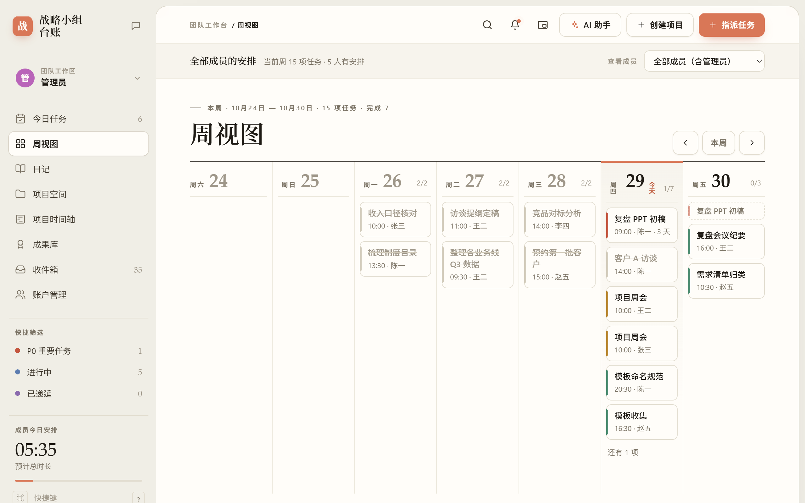
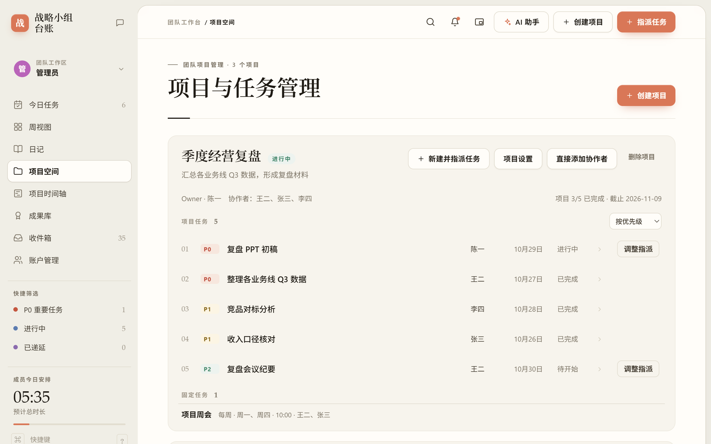
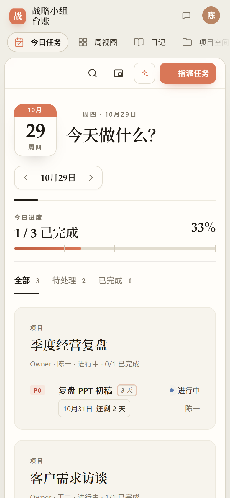

# Work Calendar

**A self-hosted task and project workbench for small teams.** One Python file and one SQLite database, no runtime dependencies, and your data stays on your own machine. The interface is in Chinese; its built-in name is 战略小组台账.

[](https://github.com/Ray-hola/work-calendar/actions/workflows/tests.yml)
[](LICENSE)
[](#requirements)
[](#requirements)

[Quick start](#quick-start) · [Docker](#docker) · [Features](#features) · [Where to change things](#where-to-change-things) · [中文](README.md)



## Why

Most collaboration tools want your tasks, daily notes and team data in someone else's cloud. Work Calendar keeps the whole loop (plan → do → finish → archive) and its rules in one auditable local service: `server.py` plus a SQLite file, reached on a local port and published through Cloudflare Tunnel or a reverse proxy when you need outside access.

## Features

**Tasks**
- Three kinds: project tasks, one-off tasks (outside any project; members create their own, admins can assign them), and fixed tasks (daily, workdays, chosen weekdays, monthly or specific dates; can belong to a project; single days can be skipped).
- Finishing a task needs no approval. The assignee can correct the completion record, and the project Owner or an admin can send it back with a reason.
- Work left unfinished, fixed tasks included, carries to the next day automatically; the old day is hidden and leaves the counts. Manual deferral to a chosen date also works.
- When assigning, you see how many hours the person already has inside the task's own dates.

**Projects**
- Members apply for projects and an admin approves them. Project settings change the name, dates and collaborators; admins can also hand a project to a new Owner.
- Project tasks sort by priority, start or end date, or a manual drag order. The timeline view draws every project on one date scale.
- Closing a project takes a report and superadmin approval; closed projects move to the achievements archive.

**Collaboration and records**
- Per-recipient inbox; a chat area with shared rooms and one room per project, with @mentions.
- Daily notes and statistics: at 23:30 each day, everyone's completed work and load are summarised.
- Desktop widget: an always-on-top picture-in-picture window with today's to-dos and a pomodoro timer (Chrome / Edge on desktop).
- AI assistant (optional): admins configure an OpenAI-compatible endpoint; the key stays on the server.

**Layout and access**
- Desktop, tablet and phone layouts.
- superadmin, admin, project Owner and collaborator roles, enforced on the server. Account management is visible to admins only, and account switching lists only accounts that signed in on that browser.

<p align="center">
  
  
</p>

## Requirements

- **Python 3.11+**, standard library only (CI runs the tests on 3.11 and 3.12).
- On Windows, time-zone data: `python -m pip install tzdata`.
- **Node.js 18+**, only for the front-end tests (CI uses 20).
- A current browser; the desktop widget needs Chrome / Edge 116 or later.

## Quick start

macOS / Linux:

```bash
./run.sh
```

Windows (PowerShell):

```powershell
Set-ExecutionPolicy -Scope Process Bypass
.\run-windows.ps1          # run in the foreground from this folder
.\install-windows.ps1      # or install to %LOCALAPPDATA%\WorkCalendar and start at sign-in
```

Open `http://127.0.0.1:4173/`. The first start creates `data/work-calendar.sqlite3` and `data/initial-accounts.txt`; the latter holds random passwords for the seeded accounts `superadmin`, `test001` (project Owner) and `test002` / `test003` (collaborators). Change them after the first sign-in.

> The page has to be served by the local server; opening `index.html` directly cannot reach the API.

### Docker

```bash
docker compose -f deploy/docker-compose.example.yml up -d --build
```

The image holds only the four runtime files, and data is mounted from the repository's `data/`. Public access, Tunnel and backups are covered in the [deployment guide](deploy/README.md#docker) (Chinese).

## Configuration

Use environment variables or command-line flags; flags win.

| Variable | Default | Meaning |
| --- | --- | --- |
| `WORK_CALENDAR_HOST` | `127.0.0.1` | Listen address; keep it on loopback behind a reverse proxy |
| `WORK_CALENDAR_PORT` | `4173` | Listen port |
| `WORK_CALENDAR_DB` | `data/work-calendar.sqlite3` | SQLite database path |
| `WORK_CALENDAR_ORIGINS` | empty | Allowed browser origins, comma-separated; required for public access |
| `WORK_CALENDAR_SECURE_COOKIE` | `0` | Set to `1` when served over HTTPS so the session cookie is `Secure` |

## Deployment

Keep the service on loopback and put Cloudflare Tunnel or Caddy / Nginx in front of it:

```bash
WORK_CALENDAR_ORIGINS=https://your-domain.example \
WORK_CALENDAR_SECURE_COOKIE=1 \
./run.sh --host 127.0.0.1 --port 4173
```

Templates for Docker Compose, Cloudflare Tunnel, Caddy, systemd, Windows scheduled tasks and backups are in [`deploy/`](deploy/). Static hosts such as Cloudflare Pages cannot run the Python + SQLite back end.

## Where to change things

```
server.py            HTTP API, permissions, SQLite storage, daily scheduler
app.js               Front-end views and interaction
index.html           Page skeleton; the two ?v= values are the asset cache version
styles.css           Styles (desktop / tablet / phone)
tests/               Back-end unittest and front-end node:test suites
deploy/              Docker Compose, Tunnel, Caddy, systemd, backup templates
Dockerfile           Container image
run.sh               Start on macOS / Linux
run-windows.ps1      Start on Windows in the foreground
install-windows.ps1  Install on Windows and start at sign-in
workbench-start.*    Windows: start the service and Tunnel, open the browser
assets/readme/       Screenshots on this page
data/                Runtime data (database, account file), never committed
```

A typical change:

1. **Interface or interaction**: edit `app.js` / `styles.css` and bump the `?v=` version in `index.html`.
2. **Rules or API**: edit the matching `action` branch in `server.py`; its permission checks live there too.
3. **Tests**: back-end behaviour goes in `tests/test_*.py`, front-end visibility and date edge cases in `tests/calendar.test.cjs`.
4. **Check locally**:

   ```bash
   python -m unittest discover -s tests -p "test_*.py"
   node --test tests/calendar.test.cjs
   ```

5. **Submit**: branch, open a pull request, and it merges into `main` once CI passes and the maintainer approves; see [`CONTRIBUTING.md`](CONTRIBUTING.md) (Chinese). Update this page and [`README.md`](README.md) when features change.

## Data and security

- The database, `initial-accounts.txt` and Tunnel credentials under `data/` stay on your machine; `.gitignore` and `.dockerignore` both exclude them.
- In production, set `data/` to `700` and the database and WAL files to `600`, and back them up regularly.
- The AI assistant's API key is stored only in the server database and never appears in audit records or state responses.
- Report security problems privately as described in [`SECURITY.md`](SECURITY.md) (Chinese), not in a public issue.

## Contributing and license

Issues and pull requests are welcome; read [`CONTRIBUTING.md`](CONTRIBUTING.md) first. Work Calendar is released under the [MIT License](LICENSE).
