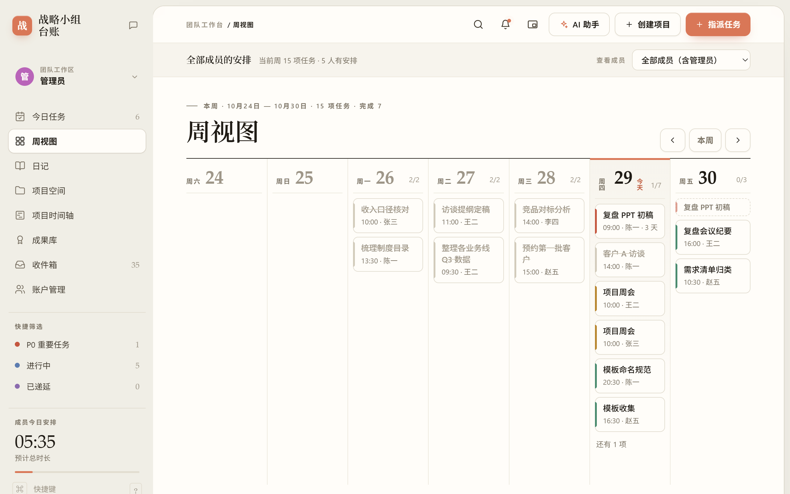
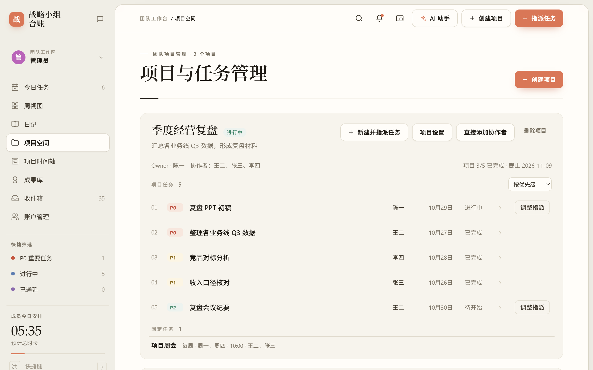
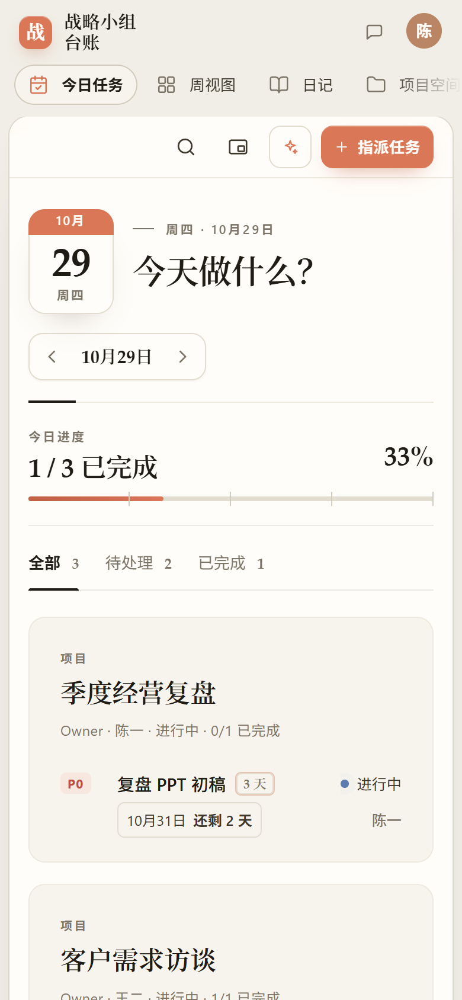

<p align="center"></p>

# Hola-Calendar

**哗啦！（哗啦待办）**：自托管的团队任务与项目协作工作台。一个 Python 文件、一个 SQLite 数据库，零运行时依赖，数据只在你自己的机器上。

[](https://github.com/Ray-hola/Hola-Calendar/actions/workflows/tests.yml)
[](LICENSE)
[](#环境要求)
[](#环境要求)

[快速开始](#快速开始) · [Docker](#docker) · [功能](#功能) · [改代码去哪里](#改代码去哪里) · [English](README.en.md)



## 为什么做这个项目

多数协作工具要求把任务、日报和成员数据放到第三方云上。Hola-Calendar 把完整的任务闭环（排期 → 执行 → 完成 → 归档）和协作规则放在一个可审计的本地服务里：`server.py` 加一个 SQLite 文件，页面通过本机端口访问，需要对外时用 Cloudflare Tunnel 或反向代理发布。

## 功能

- 界面语言：每个人在头像菜单（或登录卡片）里选简体中文或 English；选择保存在账户上，也记在浏览器里（`localStorage` 的 `hola-lang`）。地址加 `?lang=en` 只让这一页显示英文，不保存。大家填写的名称不会被翻译。

**任务**
- 三种任务：项目任务、临时任务（不挂项目，成员可按规则给自己或其他成员创建，创建人跟进进度并处理修改申请）、固定安排（每天 / 工作日 / 每周几 / 每月 / 指定日期，可挂到项目，单日可挖空）。
- 完成即结束，不需要审批：执行人可以修改完成记录，项目 Owner 或管理员可以写明原因打回。
- 当日没做完的任务（包括固定安排）第二天自动递延，旧的那天隐藏且不计入统计；也可以手动递延到指定日期。「已递延」及其计数只显示仍待开始或进行中的递延任务，多次递延只显示当前一条；完成或跳过后移出，打回后重新出现，递延历史仍保留在任务详情中。
- 固定任务递延合并：superadmin 可在「系统设置 → 日程 → 固定任务递延合并」打开开关，默认关闭。开启后，同一规则、成员和项目的前期递延在下一期开始时间到达后，待开始和进行中的未完成期次按同一规则显示为一张标着「2 期」「3 期」的卡片；单次快照内，任务状态、隐藏关系和期数共用同一个时间基准与分组结果。尚未到开始时间的期次、不同成员和同名不同规则分别保留。成员完成一次即可结清整组，原始期次与日志不删除，实际耗时只记录一次；「N 期」是合并的期数，不是递延天数或工时倍数。整组也可一起手动递延。任务记录按原始期次分组，合并完成、递延、打回和修正分别保存当时的期次范围，耗时不重复展示。关闭开关会重新展示尚未处理的独立期次，已合并完成的历史仍只记一次完成。今日、周视图、详情、统计及 AI 查询使用同一分组口径；SQL `tasks.stackCount` 表示倍数（普通任务为空，按需使用 `coalesce(stackCount,1)`），全部原始记录仍可从 `task_history` 查询。
- 指派时按任务自己的起止时间显示对方已安排的工时。
- 键盘：按 `?` 查看快捷键；`/` 搜索，`N` 新建任务，`T` / `W` / `P` / `I` 切到今日任务、周视图、项目空间、收件箱，`H` 打开使用教程。输入时不会触发。
- 分步导览：每个账户首次在桌面进入时提示，也可从使用教程重新开始。有表单、未保存内容、录音或打开的助手面板时等待当前操作结束；「试一试」只放行指定控件，操作生效后继续，也支持 Enter／空格操作和 Esc 退出。空间不足时收起卡片内演示，保留真实控件的点击区域；退出后恢复页面、筛选、周次和焦点。项目目录在大于 760px 的窗口支持拖动及键盘调宽，手机上保留折叠布局。

**项目**
- 规则组：在侧栏「系统设置」里（和 superadmin / admin / 普通用户这三种权限组分开），已有的规则组以列表显示，新建或点开某一组时是一张卡片：一键选新项目、临时任务、在参与的项目里建任务是「直接创建 / 需要审批 / 不允许」，AI 助手是「关闭 / 查询与规划 / 可代为操作」，成员直接在卡片上点选、可全选；没分组的成员按「默认规则」：申请项目、可直接建临时任务、助手可查询与规划。项目任务申请由该项目 Owner 审批，临时任务申请由管理员审批。顶栏按规则显示「+ 新项目 / 申请项目」「+ 新任务 / 申请任务」。日记自动化规则也在「系统设置」里，「账户管理」只管账户本身。
- 项目会议：通过项目文件的「新增文件 → 新增会议」保存会议时间、参会人和议程；会议原稿可以粘贴或用浏览器连续语音识别实时录入，录入过程自动保存。管理员在「系统设置 → 会议 → 会议纪要提示词」统一维护模板，重新整理已有会议也使用最新模板。会议结束后可调用已配置的 AI 模型生成会议纪要，原始转录与整理结果分开保留，方便复核和再次整理。生成纪要等待模型时不会占用工作台全局锁；若期间原稿或模板变化，旧结果不会覆盖新内容。项目结项、归档或到期后，原稿和纪要仍可从项目文件归档只读查看。
- 工作台语音输入：任务／项目描述、完成总结、递延说明、沟通区聊天和其他可编辑的多行文本框共用现有语音转写服务，无需先打开 AI 助手。点击输入框右下角的麦克风开始，再点结束；转写内容只填入原输入框，可编辑后自行提交。优先使用已配置的服务端转写，浏览器语音识别作为兜底；无可用引擎时隐藏入口。切换输入框、聊天频道、页面、账户或关闭弹窗会取消原录音／转写，迟到的结果不会写到别处。服务配置仍由管理员管理；普通账户只获取是否可用，不获取服务地址和密钥，AI 助手未开放也可使用普通表单语音输入。
- 设置开关：递延合并与项目自动补报使用开关，切换后立即保存；关闭项目自动补报会保留原来的补报周期与时间，个人日记统计继续运行。
- 项目设置可改名称、日期和协作者，管理员还可以更换 Owner。添加协作者后直接加入并通知，无需接受邀请；成员可退出，原有任务与记录保留。新加入的项目和收到的任务会在项目空间显示新标记，打开后清除。
- 无期限项目的人力统计只看今天前 6 天至后 7 天，有截止日期的按项目周期统计；任务与区间相交即计入，递延链只算当前记录，跳过项不计入。项目人力的进行中、已完成和工时采用相同区间。
- 项目内任务可按优先级、开始 / 结束时间排序或手动拖拽；项目时间轴按统一日期刻度展示。
- 项目空间提供「文件夹 → 项目 → 会议 / 文件」目录，任务、会议、文件、成员和背景使用同一组标签切换。长名称在目录中换行显示；会议保存后保留当前编辑区，切换前提示未保存的修改。管理员管理全部文件夹；普通成员的接口与目录只返回其可见项目使用的文件夹。背景保存期间继续编辑的内容会保留为待保存，失败后可以重试。
- 项目目录贴在页面最左侧。点文件夹列出其中全部项目，可按目录顺序、名称、截止日期、完成度或创建时间排序；点项目卡片或目录里的项目进入项目空间。管理员可拖动全部条目，项目 Owner 可拖动自己的项目：落点线贴左表示与文件夹平级，偏右表示放进文件夹，悬在文件夹上松开则直接收进文件夹。
- 项目标题可用键盘聚焦后按 Enter 打开。目录拖拽移出目录、按 Esc、窗口失焦或指针取消时不保存；保存期间不启动第二次拖拽，失败后恢复服务端状态。拖拽动效遵循系统「减少动态效果」设置。
- 项目文件支持选择或拖拽上传，单个最大 20MB；列表直接显示「打开 / 下载 / 删除」，点文件名或左侧文件目录进入文件详情（Markdown 为编辑器），下载不再混在打开动作里。上传者、项目 Owner 和管理员按原权限删除；逾期项目仍可继续管理文件和会议。已结项、归档的项目收在项目目录下方的「成果库」里：管理员看到全部，成员看到自己参与过的，可进入项目文件和沟通记录只读查看、下载；其他成员无权访问，这些文件不能继续上传或删除。
- 内容删除：会议列表和编辑区均提供删除入口，会议创建者、项目 Owner 或管理员可删除仍有访问权的会议，原稿和纪要一并删除。文件列表始终显示「删除」，Markdown 打开窗口也提供「删除文件」；权限沿用上传者、Owner 或管理员。所有删除均需确认；归档内容保持只读，取消或失败会保留当前内容与草稿。
- Markdown：项目背景、会议纪要和 `.md` 文件支持渲染与编辑。新建会议即可保存手写纪要；在线文件保存与上传同为最大 20MB（UTF-8 字节数）。上传者、项目 Owner 和管理员可编辑文本文件，归档后只读；切换账户、项目或关闭窗口会使尚未完成的文件读取失效。
- 项目 Owner 提交结项报告，由管理员审批；管理员也可直接完成项目。支持提前结项，确认时列出尚未完成的任务，结项后这些任务一并关闭，项目进入成果库。

**协作与记录**
- 沟通区按频道和消息时间索引查询，时间相同则按写入顺序展示；系统时钟回拨或历史消息补写不会让旧消息覆盖频道预览。刷新保留全部未读与审批类通知，其余已读通知只带最近 200 条，数据库中的历史通知不删除。
- 聊天历史可从顶部逐页加载更早的消息；翻页和新消息轮询共用完整排序键，时间戳相同也不会漏读或重复。再次点击当前快捷筛选可回到全部任务；图片、PDF 和 UTF-8 文本附件可预览，其他文件继续下载。
- 收件箱按收件人隔离，可以单条删除，也可以进入「管理」批量删除或清除已读；沟通区有公共频道和每个项目的频道，支持 @提及。
- 档案室（原「日记」与「档案室」合并）：每月一个线稿档案盒，左右箭头换月份；鼠标在盒子上滑动、拖动下方的日期刻度尺或滚动滚轮挑选档案，点开看全文。成员查看自己的个人档案，管理员查看团队日报并可查阅成员日记；项目 Owner 不会收到成员日记正文：
  - 成员：每天一份自己的档案，按当天任务自动套好「今日完成 / 未完成与阻塞 / 明日计划」，附当天的工作日志，并有独立的「随记」区（不纳入团队日报）；打开就能直接改，改完保存。「记录今天」直接打开今天这份。每天 23:30 没写的会按任务自动整理。
  - 管理员：每天一份团队日报（第二天自动生成，汇总成员总结、项目进展和需要关注的事项），同样可以直接改，之后补交的日记不会覆盖改过的内容；盒子下方是所选那天的工作日志、成员负载和项目进度。「本周周报」按设置的周起始日（默认周六到周五）整理项目与任务成果：「这周做了什么」保留已完成项目的名称、项目描述与结项说明，并纳入本周实际完成的任务，带任务描述、完成总结和反馈；项目未结项也会纳入已完成任务，临时任务与固定任务同样计入，已结项项目的任务放在项目下展示。「还有什么没做」按未完成项目列出剩余任务、原因及后续安排。项目与任务分别按实际完成时间归周，待审批的结项不算项目完成；递延链和合并期次去重，历史周按当周截点判断，后续的重做或总结修改不写回较早周次。缺失描述如实显示，不编造结果。保留历史周切换与已归档日报入口。
- 桌面小组件：可置顶的画中画小窗，显示今日待办并带番茄钟（Chrome / Edge 桌面版）。
- AI 助手（可选）：管理员配置 OpenAI 兼容接口，Key 只保存在服务端。任务和项目的创建、修改、删除都通过同一套可编辑管理卡片：普通聊天可直接起草，也可点「管理任务 / 项目」。创建卡支持补齐负责人、日期和优先级；修改卡显示原值与拟修改值，只提交实际变化的字段，项目协作者增删也在同一张卡里检查；删除卡显示影响范围，项目删除须亲自输入完整名称。每张卡可独立「接受 / 拒绝」，也可全选或多选后「接受所选 / 拒绝所选」，底部「全部接受」处理所有待办卡片；缺字段、失败或尚未操作的卡片继续保留。接受或拒绝后以简短上浮淡出动效退场，减少动态效果设置下跳过。所有卡片均需手动接受，「替我确认」不会自动提交这些卡片。最终按你自己的权限直接执行或提交审批。
- AI 接入：在「系统设置 → AI 接入与模型」里添加来源（OpenAI、Claude（需 OpenAI 兼容网关）、Google Gemini、DeepSeek、Kimi、通义千问、智谱、硅基流动、OpenRouter、本地 Ollama 或任意 OpenAI 兼容地址，以及语音转写服务），密钥只保存在服务端；保存后立即测试并取回该来源的模型列表，失败时说明原因。再为对话助手、规划任务、会议纪要、语音转写分别选择来源和模型，规划任务和会议纪要也可以跟随对话助手。没设置过的旧安装照常使用原来的模型配置。AI 助手面板的齿轮直接打开这一页；会议纪要提示词也有自己的子页面。
- 项目会议：项目内通过「任务 / 会议 / 文件 / 成员 / 概况」切换，会议列表、原稿和纪要在同一空间编辑；左侧项目节点可展开会议和文件，并打开文件管理界面。配置语音服务后，实时录入每约 4 秒提交一个完整音频短段，录音未结束就持续追加和保存原稿；实际延迟取决于服务响应。停止、保存或切换前等待尾段处理；失败片段保留在当前页面可重试，慢服务最多积压 3 段后暂停录音。未配置服务时使用浏览器实时识别；刷新或关闭页面会丢失尚未处理的内存音频，请先完成重试。会议自动保存有版本检查，冲突时保留本机输入并提示处理。归档会议只读。刷新只带会议摘要，打开时按权限读取全文；切换会议、页面或账户后，迟到响应不会重新打开旧会议。
- 思考强度：对话助手、规划任务和会议纪要可分别选择默认、关闭、极低、低、中、高、极高或最高；跟随对话助手时继承其强度。「默认」使用服务商设置，其他档位需要模型/网关支持 `reasoning_effort`，不支持时应选择默认。显式设置会省略温度参数以避免兼容冲突；高强度可能增加响应耗时与 token 用量。
- AI 设置保护：连接测试不会清空其他来源的未保存输入；连续切换场景模型按顺序保存。模型列表和密钥状态只来自所选来源，修改地址或密钥后，旧测试结果不会覆盖新配置。语音来源支持保存测试取得的模型列表；在语音转写的来源中选择「停用」即可关闭，再删除不再使用的来源，重新选择来源和模型可启用。
- 按需检索：聊天开始只提供身份、日期、权限和工具说明，不再默认发送工作台快照。助手通过 `workspace_schema`、`workspace_query` 和 `workspace_read` 查询当前账户有权查看的任务、项目、日志、日报、日记等资料，在只读 SQL 工作区完成关联和统计；长记录支持连续读取。任务和项目增删改统一由 `work_cards` 起草，旧 `<action>` 格式也会转入管理卡片；其他管理操作继续使用 `business_action`。
- 修改与删除保护：卡片绑定目标资料版本；确认期间目标或项目待删除的关联资料（包括会议原稿、纪要和项目频道消息）变化时会拒绝提交；删除卡片列出会议和沟通记录数量。点「重新读取」可保留拟修改字段并重新检查；删除确认需要重新填写。失败卡片保留原因，重试不会再次提交已成功的卡片；拒绝只移除本次提议，不改业务数据，可在未有后续成功提交前撤销。未处理卡片的内容、勾选和处理结果会保存并可在刷新后恢复。
- 对话容量：总输入（含指令、工具定义、历史和查询结果）限制为 1.6 万、3.2 万或 6.4 万字符，默认 3.2 万；发送前严格检查，优先省略较早的历史和工具轮次，保留当前问题。每轮最多调用 8 次工具，查询有行数、文本和计算时限；容量不足会提示缩小范围。旧容量设置会映射到新档位。回复显示简短的查询次数，原始 SQL 不进入聊天正文。
- AI 协同：规划卡片在对话左侧展开，手机上切换为上下布局。缺少名称或无法确定的负责人会保留为空并标红，补齐后才能确认；模型回复不完整或连接失败时保留原请求供重试，不会把修改／删除请求变成新建卡。支持 ↑ 召回上次输入、消息复制、修改重发、回退当前对话，以及草稿撤销与复制。处理中可暂停 / 继续，停止后保留草稿与执行记录；已经发出的操作会先完成回执，再停止后续步骤。回退对话不会撤销已创建的数据。
- 对话记录：在助手左侧新建、切换、重命名或删除对话；空对话也会保存。助手文字按钮统一为 32px 高，成对操作等宽；复制、修改重发、回退使用气泡下方的 12px 图标，桌面悬停或键盘聚焦时显示，触屏保持可见。界面只保留必要的字段、状态、错误和删除影响。卡片编辑和处理决定保存到服务端，未发送输入在当前页面按对话保留；管理员查看他人记录时只读，不能执行草稿。历史加载完成前禁止发送，较晚返回的旧记录不会覆盖新选择。
- 助手恢复：每张管理卡使用稳定 ID 与持久执行回执，响应丢失后重试不重复创建。草稿有版本冲突保护和按账户隔离的本机恢复副本；旧版历史草稿没有可验证的执行状态，明确使用「复制为新草稿」。修改重发／回退持久切换当前对话分支，保留真实业务记录；迟到回复不能恢复已删对话。
- 助手反馈：窄屏可切换「管理卡片／对话」，继续提问会显示回答与错误；批量按钮明确显示处理范围和数量。长流程保留原始目标，写入成功与界面核对失败分别报告，测试模型连接不会占用工作台全局锁。
- 助手凭据：新 API 根地址不会继承旧密钥，可明确选择无密钥或移除服务端模型密钥。账户创建的初始密码在确认卡中单独输入，仅提交工作台，不发送给模型，也不进入操作／审计记录。启动时一次性脱敏旧助手／审计记录中的结构化凭据，不改变项目、任务和密码哈希。
- 个性签名：在「我的资料」里写一句话，显示在头像下方（侧栏、账户菜单和账户列表）。

**界面与权限**
- 系统设置按「成员与权限、日程、日报与补报、会议、AI 助手」分类：左侧分类随滚动高亮，顶部可搜索设置（按 `/` 聚焦）；每项设置一行，开关与补报时间修改后自动保存，会议提示词点击「保存」提交；补报的连续修改按顺序保存，刷新和保存失败保留草稿，恢复默认同步更新输入框。保存结果就地显示，和默认值不同的设置左侧有一条竖线和「恢复默认」。
- 桌面、平板、手机三档布局。管理员可在「系统设置」选择每周起始日，全员的周视图、档案室周范围与周报统一生效。
- AI 助手支持拖动左边缘调宽、上边缘调高、左上角同时调整宽高，调整边缘透明，不显示滑条。普通对话、对话记录、规划及两者同时打开时分别记住尺寸；缩小屏幕只临时限制尺寸，不覆盖原设置。双击边缘恢复默认，拖动时按 Esc 取消；聚焦边缘后可用方向键微调、Shift 加速、Home 恢复默认、End 到上限。
- 全站隐藏滚动条，仍可用滚轮、触控和键盘滚动。主导航、项目目录和沟通区频道栏可拖动右侧边缘调整宽度，并用顶部箭头收起 / 展开；最窄时保留图标和完整名称提示，溢出的文字在末尾自然淡化。桌面宽度范围分别为 72–360、56–340、64–320 px，实际最大值会随可用空间缩小，给正文留出位置。宽度和上次展开尺寸保存在当前浏览器，刷新后恢复。
- 分隔线支持键盘：左右方向键微调，Shift 加速，Home / End 到上下限，Enter 收起 / 展开，双击恢复默认宽度；拖动时按 Esc 取消。手机保留横向主导航；平板和手机的项目目录、手机的频道栏使用收起 / 展开，避免挤压正文。动效遵循系统「减少动态效果」偏好。
- 身份只有 superadmin、admin、普通用户三种权限组；项目里的 Owner / 协作者只决定在该项目里能做什么。越权操作由服务端拒绝。账户管理只对管理员可见：superadmin 可以拖动账户调整顺序或换权限组，也可以在某个权限组上点「管理」，勾选多个账户后停用 / 启用、删除、重置密码为 123456 或设置中文名。头像菜单里的切换账户只列出在本浏览器登录过的账户。
- 登录校验在锁外计算密码哈希，签发会话前在锁内复核当前凭据和账户状态；校验期间重置密码、停用或重建账户，旧结果不能生成会话。登录失败按账户和来源组合记入 15 分钟窗口；缓存全局过期清理，最多保留 4096 个最近失败组合、每组最多 8 条，满时淘汰最久未失败的组合，键使用固定长度摘要。

<p align="center">
  
  
</p>

## 环境要求

- **Python 3.11+**，无第三方依赖（CI 在 3.11 和 3.12 上运行测试）。
- Windows 需要时区数据：`python -m pip install tzdata`。
- **Node.js 18+**：只有运行前端测试时需要（CI 使用 20）。
- 现代浏览器；桌面小组件需要 Chrome / Edge 116 以上。

## 快速开始

macOS / Linux：

```bash
./run.sh
```

Windows（PowerShell）：

```powershell
Set-ExecutionPolicy -Scope Process Bypass
.\run-windows.ps1          # 在当前目录前台运行
.\install-windows.ps1      # 或安装到 %LOCALAPPDATA%\WorkCalendar 并登录自启
```

已有部署升级无需迁移数据；`WORK_CALENDAR_*` 环境变量、`data/work-calendar.sqlite3` 和部署服务标识继续兼容。

打开 `http://127.0.0.1:4173/`。首次启动会创建 `data/work-calendar.sqlite3` 和 `data/initial-accounts.txt`，后者记录预置账户 `superadmin`、`test001`（项目 Owner）、`test002` / `test003`（协作者）的随机密码，首次登录后请修改。

> 页面必须通过本地服务访问，直接双击 `index.html` 连不上接口。

### Docker

```bash
docker compose -f deploy/docker-compose.example.yml up -d --build
```

镜像只包含四个运行文件，数据挂载在仓库的 `data/`。对外服务、Tunnel 和备份见 [部署指南](deploy/README.md#docker)。

## 配置

环境变量与命令行参数都可以，命令行参数优先。

| 变量 | 默认值 | 说明 |
| --- | --- | --- |
| `WORK_CALENDAR_HOST` | `127.0.0.1` | 监听地址；用反向代理时保持本机回环 |
| `WORK_CALENDAR_PORT` | `4173` | 监听端口 |
| `WORK_CALENDAR_DB` | `data/work-calendar.sqlite3` | SQLite 数据库路径 |
| `WORK_CALENDAR_ORIGINS` | 空 | 允许的浏览器 Origin，逗号分隔；对外服务时必填 |
| `WORK_CALENDAR_SECURE_COOKIE` | `0` | 通过 HTTPS 访问时设为 `1`，给会话 Cookie 加 `Secure` |

## 部署

让服务只监听本机，再由 Cloudflare Tunnel 或 Caddy / Nginx 转发：

```bash
WORK_CALENDAR_ORIGINS=https://your-domain.example \
WORK_CALENDAR_SECURE_COOKIE=1 \
./run.sh --host 127.0.0.1 --port 4173
```

Docker Compose、Cloudflare Tunnel、Caddy、systemd、Windows 计划任务与备份模板都在 [`deploy/`](deploy/)。Cloudflare Pages 这类静态托管跑不了 Python + SQLite 后端。

## 改代码去哪里

```
server.py            HTTP 接口、权限、SQLite 存储、调度与助手工具循环
agent_workspace.py   隔离只读 SQL 工作区、工具定义、分页与记录读取
assistant_privacy.py  连接密钥绑定与助手记录脱敏
app.js               前端视图与交互；界面文字用中文写在 tr('…') 里
i18n.js              英文界面词典（键是中文原文）
index.html           页面骨架；?v= 是静态资源的缓存版本号
styles.css           样式（桌面 / 平板 / 手机三档）
tests/               后端 unittest 与前端 node:test 回归测试
deploy/              Docker Compose、Tunnel、Caddy、systemd、备份模板
Dockerfile           容器镜像
run.sh               macOS / Linux 启动
run-windows.ps1      Windows 前台启动
install-windows.ps1  Windows 安装并登录自启
workbench-start.*    Windows 一键启动服务与 Tunnel 并打开浏览器
assets/readme/       本页截图
data/                运行时数据（数据库、账户文件），不进版本库
```

一次常见改动的路径：

1. **改界面或交互**：改 `app.js` / `styles.css`，同时更新 `index.html` 里的 `?v=` 版本号。新增的界面文字写成 `tr('中文')`，并在 `i18n.js` 补上英文。
2. **改规则或接口**：改 `server.py` 中对应的 `action` 分支，权限检查也在那里。
3. **补测试**：后端行为写进 `tests/test_*.py`，前端可见范围和日期边界写进 `tests/calendar.test.cjs`。
4. **本地验证**：

   ```bash
   TZ=Asia/Shanghai python -m unittest discover -s tests -p "test_*.py"
   TZ=Asia/Shanghai node --test tests/calendar.test.cjs
   ```

5. **提交**：开分支、发 Pull Request，CI 通过并经维护者批准后合入 `main`，规则见 [`CONTRIBUTING.md`](CONTRIBUTING.md)。功能变化时同步更新本页和 [`README.en.md`](README.en.md)。

## 数据与安全

- `data/` 下的数据库、`initial-accounts.txt` 和 Tunnel 凭证只留在本机，`.gitignore` 与 `.dockerignore` 都已排除。
- 生产环境把 `data/` 权限设为 `700`、数据库与 WAL 文件设为 `600`，并定期备份。
- AI 助手的 API Key 只保存在服务端数据库，不会出现在审计记录或状态响应里；更换服务地址不会自动沿用旧密钥。
- 发现安全问题请按 [`SECURITY.md`](SECURITY.md) 私下报告，不要直接开公开 Issue。

## 贡献与许可证

欢迎 Issue 和 Pull Request，先读 [`CONTRIBUTING.md`](CONTRIBUTING.md)。本项目基于 [MIT License](LICENSE) 开源。
